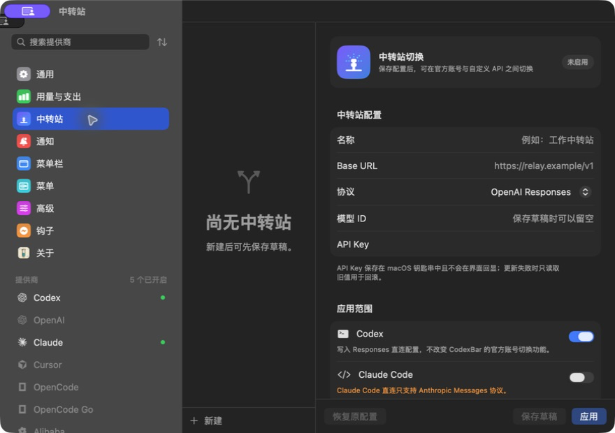

# CodexBar Relay Fork Scope

This fork keeps CodexBar as the native Swift menu-bar application and ports only the direct
configuration-switching ideas needed from CC Switch.

## Product scope

- Keep CodexBar's existing official Codex account discovery and account switching.
- Add direct relay profiles for exactly five targets: Codex, Claude Code, Claude Desktop,
  Grok Build, and OpenCode.
- Keep token and estimated-cost usage. A relay may optionally provide a token-usage query, but
  balance queries are out of scope.
- Keep the existing provider implementations for now. Disabled providers do not perform normal
  background refreshes, so pruning them is not required for the first release.
- Do not port CC Switch's OAuth account pool, local CPA/protocol proxy, MCP management, balance
  dashboard, or unrelated application integrations.
- Store relay secrets in Keychain and persist only a credential reference in the profile database.
  The settings editor intentionally reads that value back into a visible text field for this fork.

## Menu behavior

- New installs default Codex multi-account mode to vertically stacked, bordered account cards while
  preserving an existing segmented preference. The menu is too narrow
  for two columns once email addresses and reset times are shown.
- Each card makes the account identity explicit and presents the weekly quota as a remaining-percent
  ring. Pace deficit/overage text and limit-reset credits are omitted.
- The merged macOS status item defaults to the colored `sprinkler.and.droplets.fill` symbol followed
  by the active Codex account's weekly remaining percentage. Liquid colors animate during refresh.
- The opened status menu contains a compact Official/relay quick switcher above the account cards.
- The active stacked Codex card includes rolling 24-hour tokens and estimated cost plus the longer
  local history line; inactive cards do not claim that local session history as their own. If the
  rolling window contains a model missing from the local price table, the UI labels a 30-day blended
  fallback with `≈` rather than presenting it as an exact model-level calculation.
- The plan-usage submenu and Codex credit-purchase UI are hidden in this fork.
- The generic Codex "Usage Dashboard" action is hidden.
- The cost overview shows rolling 24-hour tokens and estimated cost when event-level Codex data is
  available. Providers with only daily aggregates keep an honest daily/latest label rather than being
  relabeled as an exact rolling window.

## Delivery status

- Implemented: account-card UI, product feature policy, and rolling 24-hour Codex summary.
- Implemented: relay profile persistence, Keychain credential references, atomic config writes,
  rollback, and restore.
- Implemented: direct writers for Codex, Claude Code, Grok Build, and recognized OpenCode V1
  configurations, including a new V1 file when none exists. Claude Desktop is intentionally
  manual-only.
- Implemented: relay profile editor with visible saved keys, compatibility blockers, first-activation
  baseline capture, per-application active-profile restore state, and menu-level quick switching.
- Implemented: the supplied clay test-tube artwork as the application icon. Relay surfaces use the
  `sprinkler.and.droplets.fill` SF Symbol with a cyan/blue palette. SwiftUI relay surfaces use a
  variable-color animation while active; the AppKit status item rotates its liquid palette during
  refresh and remains colored at rest.
- Pending a relay-specific API contract: remote relay usage-query adapters. Local Codex session logs
  already provide the rolling token and estimated-cost display.

The relay settings pane was launched as an isolated native macOS app with temporary Codex, Claude,
Grok, and OpenCode paths. The UI, endpoint validation, and draft persistence were exercised without
storing an API key or changing the user's real client configuration.

The relay layer writes application configuration directly. Rust is not part of the initial design;
it would only become useful if protocol conversion or a local failover proxy returns to scope.

## Direct-connection compatibility

The fork never claims that a relay works merely because it has a URL and a key. A target can be
enabled only when its native wire format and required model are known:

| Target | Direct wire format | Notes |
| --- | --- | --- |
| Codex | OpenAI Responses | Preserve `auth.json`; use command-backed auth for the Keychain item. |
| Claude Code | Anthropic Messages | Patch `settings.json` by field and use `apiKeyHelper`. |
| Claude Desktop | Anthropic Messages | Automatic switching is unsupported initially; use the official Third-Party Inference UI. |
| Grok Build | OpenAI Responses | Requires a model actually served by the relay. |
| OpenCode | Responses, Chat Completions, or Anthropic | Write recognized V1 config; refuse V2 or ambiguous schema for now. |

An OpenAI-compatible URL without a confirmed model ID is saved as a draft and is not activated.
Switching never relies on the CPA/local protocol-conversion proxy from CC Switch.
A single profile applies only to clients compatible with its selected wire format. Use separate
profiles for OpenAI Responses and Anthropic Messages endpoints unless per-target protocol overrides
are added later.

## Credential boundary

CodexBar stores its source-of-truth credential in Keychain and intentionally displays it in the relay
settings text field when that profile is selected. It is still excluded from profile JSON and Git.
Codex and Claude Code can read it
through the bundled `CodexBarCLI` command-backed credential helper. Grok Build and OpenCode currently
need a credential copy in their own configuration; the UI discloses that boundary before writing.
Relay secrets must never appear in the profile JSON, backup manifest, diagnostics, test fixtures, or
application logs. Secure backup payloads can contain pre-existing client credentials and therefore
use private directories and `0600` files.

The helper prevents a generic `/usr/bin/security` command from being trusted by the Keychain item,
but it is not a same-user process sandbox: another process running as the same macOS user could invoke
the bundled helper if it learns an opaque credential reference. A future hardened build can move this
boundary to a signed XPC service if that threat model becomes a requirement.

The first activation snapshots all four automatically writable client configurations. Later profile
switches keep that original baseline, so restoring also covers targets introduced after the first
switch. Per-switch and restore-safety backups are deleted after success so copied client secrets do
not accumulate; a failed switch also deletes its temporary backup after a complete rollback, while a
rollback failure retains it for recovery. The original baseline is deleted after a successful
restore. Claude Desktop is excluded from both automatic writes and this baseline.

Existing OpenCode JSONC comments are never silently erased. Until a comment-preserving editor is
added, the writer refuses such a file and leaves it unchanged. `CODEX_HOME`, `CLAUDE_CONFIG_DIR`,
`GROK_HOME`, and the file-valued `OPENCODE_CONFIG` override are honored when they contain absolute or
home-relative paths.

## Development verification

- `CodexBarCore`, `CodexBar`, and `CodexBarCLI` compile with Swift 6 in the current Command Line Tools
  environment. The app build uses the repository's `CODEXBAR_NO_SWIFTUI_MACROS` compatibility flag.
- A release-mode arm64 menu-bar app was launched and visually checked on macOS 26. Its settings UI,
  relay draft flow, supplied app icon, colored SF Symbol, and native bundle signature were verified.
- The local Command Line Tools package omits the WidgetKit extension. The checked-in GitHub workflow
  selects full Xcode and remains the release gate for the widget and Swift Testing suites.
- A standalone smoke harness compiles the same relay core sources and verifies endpoint policy,
  TOML table replacement, OpenCode creation/comment refusal, transactional rollback, baseline restore,
  and backup cleanup against temporary files.
- SwiftFormat, strict SwiftLint, diff whitespace checks, the relay CLI help/error path, and a source
  credential scan pass locally.
- The repository's Swift Testing suites cannot execute with Command Line Tools alone because the
  installed toolchain has no importable `Testing` module. Run the checked-in tests with full Xcode in
  CI or before release.
